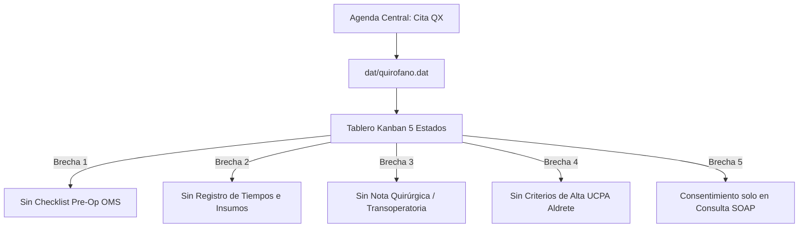
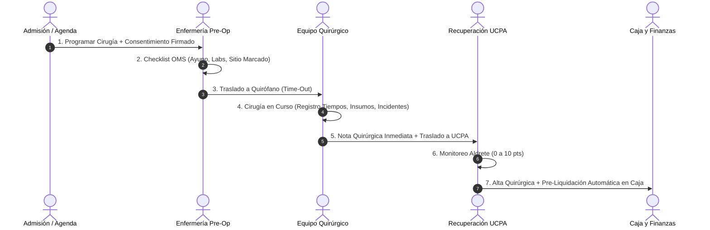

# 04. Blueprint de Trazabilidad Quirúrgica End-to-End y Repositorio de Consentimientos Informados

## 1. Visión y Alcance
Este documento establece las especificaciones maestras para elevar el módulo de **Quirófano** y el subsistema de **Consentimiento Informado** de OsPulso a un estándar hospitalario internacional (alineado con la NOM-004-SSA3-2012 del Expediente Clínico, NOM-006-SSA3-2011 para la práctica de la Anestesiología y la iniciativa "Safe Surgery Saves Lives" de la Organización Mundial de la Salud).

---

## 2. Diagnóstico del Estado Actual vs Brechas Críticas



### Brechas Identificadas:
1. **Consentimiento Fragmentado**: El consentimiento informado actual vive atado exclusivamente a una consulta médica ambulatoria (`id_consulta`) y se almacena en un `.dat` plano monolítico. Si el paciente ingresa directamente a cirugía o procedimiento mayor, el consentimiento queda desvinculado o inaccesible desde el expediente principal.
2. **Tablero Quirúrgico de Solo Estado**: El Kanban actual cambia el estado de la cirugía (`Programada` ➔ `Pre-Op` ➔ `En Quirófano` ➔ `Recuperación` ➔ `Alta`), pero opera como un tablero superficial sin bitácora transoperatoria, sin firmas de instrumentista/circulante ni tiempos quirúrgicos reales.
3. **Ausencia de Blindaje Médico-Legal**: No se captura la Hoja de Técnica Quirúrgica / Post-Operatoria obligatoria por ley inmediatamente al terminar la cirugía.
4. **Fuga de Insumos y Costos**: El tiempo en sala y los insumos quirúrgicos no se empaquetan automáticamente hacia el Estado de Cuenta del paciente (`estado_cuenta.dat`), dependiendo de capturas manuales posteriores en caja.

---

## 3. Arquitectura del Repositorio de Consentimientos Informados (Patrón Odontograma)

Siguiendo el exitoso patrón implementado en Odontología (`dat/odontogramas/paciente_<id>.json`), el sistema de consentimientos informados evoluciona a un **Repositorio Atómico y Tipificado**:

### 3.1 Estructura en Sistema de Archivos
- **Ruta de Repositorios Atómicos**: `dat/consentimientos/paciente_<id_paciente>.json`
- **Índice Global Multi-Tenant**: `dat/consentimientos.dat` (conservado para búsquedas ultrarrápidas y compatibilidad de impresión).
- **Firmas Digitales**: `uploads/firmas/CNS-<timestamp>_<tipo>.png`.

### 3.2 Tipos Canónicos de Consentimiento
1. `CONSULTA_PROCEDIMIENTO`: Procedimientos menores en consultorio.
2. `CIRUGIA_MAYOR`: Procedimientos quirúrgicos hospitalarios (requiere testigos, cirujano y anestesiólogo).
3. `ANESTESIA`: Procedimiento anestésico y sedación (valoración de vía aérea y riesgos).
4. `HEMODERIVADOS`: Transfusión de paquetes globulares, plasma o plaquetas.
5. `REVOCACION`: Declaración formal de retiro de consentimiento.

### 3.3 Esquema del JSON Atómico (`paciente_<id_paciente>.json`)
```json
{
  "id_paciente": "48",
  "documentos": [
    {
      "id_consentimiento": "CNS-1729555200-842",
      "tipo": "CIRUGIA_MAYOR",
      "fecha": "2026-10-22",
      "hora": "09:30",
      "procedimiento": "Apendicectomía Laparoscópica",
      "diagnostico": "Apendicitis Aguda",
      "id_medico": "DOC-102",
      "nombre_medico": "Dr. Fernando Morales",
      "id_cirugia": "QX-20261022-01",
      "id_consulta": "",
      "beneficios": "Resolución del cuadro infeccioso agudo...",
      "riesgos_complicaciones": "Sangrado, infección de herida, lesión visceral...",
      "alternativas": "Manejo médico conservador (no indicado)...",
      "firmas": {
        "paciente": "uploads/firmas/CNS-1729555200-842_paciente.png",
        "medico": "uploads/firmas/CNS-1729555200-842_medico.png",
        "testigo_1": "uploads/firmas/CNS-1729555200-842_testigo1.png"
      },
      "estado": "Firmado"
    }
  ]
}
```

### 3.4 Gobernanza en Wizard SOAP: Interruptor en Paso 0 Registro
- **Regla de Oportunidad y Agilidad**: Para evitar fricción en consultas rutinarias de revisión o recetas médicas, en el Step 0 ("Registro", `step_registro_privado.pl`) se incorpora el interruptor:
  *¿Requiere Consentimientos & Docs Legales para esta consulta?* (`#check_requiere_consentimiento_registro`).
- **Comportamiento Reactivo**:
  - Si el profesional selecciona **NO** (o permanece apagado por defecto):
    - En el Step 5 ("Acuerdos", `step_comunicacion.pl`), el módulo legal se **inhabilita visualmente** y colapsa, mostrando un aviso informativo y permitiendo transitar fluidamente hacia Caja y Cierre sin capturar firmas ni validar campos obligatorios legales.
    - Al sellar la consulta, no se generan archivos residuales ni registros vacíos.
  - Si el profesional selecciona **SÍ**:
    - Se habilita el formulario completo en Step 5 para capturar el procedimiento, objetivos, beneficios, riesgos y firmas digitales de paciente y facultativo.
    - Se archiva atómicamente en `dat/consentimientos/paciente_<id>.json` e indexa en `dat/consentimientos.dat`.
- **Repositorio en Expediente Clínico**:
  - En `render_expediente_clinico.pl`, la pestaña `tab11` (**Consentimientos Legales**) expone el historial completo de documentos firmados del paciente, con KPIs de documentos y opción de emisión directa fuera de consulta SOAP.

---

## 4. Pipeline Quirúrgico End-to-End (4 Fases Clínicas)



### Fase 1: Admisión y Pre-Operatorio (Safe Surgery Check-In)
- **Checklist Preoperatorio Digital**:
  - [x] Verificación de identidad con 2 identificadores.
  - [x] Consentimiento Informado Quirúrgico & Anestésico verificado y firmado.
  - [x] Ayuno confirmado (horas de sólidos y líquidos claros).
  - [x] Pruebas de laboratorio y gabinete validadas (TP, TTP, Plaquetas, Hb, Grupo y Rh).
  - [x] Marcaje del sitio quirúrgico realizado por el cirujano.
  - [x] Vía venosa permeable y profilaxis antibiótica administrada (<60 min antes de incisión).

### Fase 2: Transoperatorio (Time-Out & Sala Activa)
- **Time Out Oficial**: Pausa de seguridad antes de la incisión con presencia de Cirujano, Anestesiólogo e Instrumentista.
- **Trazabilidad de Tiempos**:
  - Ingreso a Sala $\to$ Inicio Anestesia $\to$ Incisión Quirúrgica $\to$ Cierre de Piel $\to$ Emersión $\to$ Salida de Sala.
- **Seguridad y Trazabilidad de Materiales**:
  - Conteo de gasas y compresas (cuenta inicial, cuenta transoperatoria, cuenta final verificada al 100%).
  - Registro de prótesis o implantes (código de barras, lote, fecha de caducidad).
  - Muestra enviada a Patología (rotulada y vinculada a solicitud).

### Fase 3: Post-Operatorio Inmediato y Recuperación UCPA
- **Nota Quirúrgica Digital NOM-004**:
  - Diagnóstico pre vs postoperatorio.
  - Operación planeada vs realizada.
  - Descripción de la técnica paso a paso.
  - Hallazgos quirúrgicos relevantes.
  - Cuantificación de sangrado y balance de líquidos.
  - Destino del paciente (UCPA cama X).
- **Criterios de Aldrete para Alta de UCPA**:
  - Evaluación de 5 parámetros (0 a 2 pts cada uno): Actividad, Respiración, Circulación, Conciencia y Saturación de $\text{O}_2$.
  - Puntuación $\ge 9$ requerida para alta a piso / domicilio.

### Fase 4: Integración Financiera y Cierre de Folio Quirúrgico
- **Generación Automática de Pre-Liquidación**:
  - Horas de sala consumidas $\times$ tarifa contratada.
  - Honorarios médicos de Cirujano, Primer Ayudante y Anestesiólogo (si son administrados por la clínica).
  - Insumos de anestesia y botiquín quirúrgico reportados por enfermería.
  - Inserción en `estado_cuenta.dat` para cobro en mostrador mediante `folios_recibos_privados.dat`.

---

## 5. Hoja de Ruta de Implementación
1. **Fase I**: Kanban Quirúrgico responsivo 100% fluido en CSS Grid (0 scroll horizontal), modal de inspección rápida y sincronización bidireccional con Agenda Central. (✅ Completada)
2. **Fase II**: Repositorio Atómico `dat/consentimientos/paciente_<id>.json`, controlador `api/consentimientos_api.pl`, pestaña `tab11` en Expediente Clínico e interruptor reactivo en Step 0 Registro para inhabilitar documentación prescindible. (✅ Completada)
3. **Fase III**: Checklist Preoperatorio OMS y Nota Quirúrgica integrada en el modal de detalle del Kanban.
4. **Fase IV**: Pre-liquidación automática de insumos quirúrgicos en el módulo financiero.
