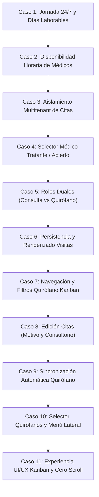

# 📋 Guion Maestro de Pruebas: Agenda Central y Quirófano Kanban

> **Ubicación Canónica**: `docs/04_standards_and_ops/guion_pruebas_agenda_quirofano.md`  
> **Versión**: `1.2.0` (Actualizado: 2026-10-21)  
> **Estado**: Activo / Reutilizable  
> **Área**: Agenda Médica, Quirófano, Expedientes y Multitenancy  

---

## 📑 Índice de Contenidos

1. [Propósito y Reglas de Mantenimiento](#1-propósito-y-reglas-de-mantenimiento)
2. [Prerrequisitos y Entorno de Ejecución](#2-prerrequisitos-y-entorno-de-ejecución)
3. [Matriz de Roles y Cuentas de Prueba](#3-matriz-de-roles-y-cuentas-de-prueba)
4. [Casos de Prueba Canónicos](#4-casos-de-prueba-canónicos)
   - [Caso 1: Jornada 24/7 y Días Laborables en Organización con CLUE](#caso-1-jornada-247-y-días-laborables-en-organización-con-clue)
   - [Caso 2: Disponibilidad Horaria de Profesionales en Agendamiento](#caso-2-disponibilidad-horaria-de-profesionales-en-agendamiento)
   - [Caso 3: Aislamiento Multitenant de Pacientes y Vista Mensual de Agenda](#caso-3-aislamiento-multitenant-de-pacientes-y-vista-mensual-de-agenda)
   - [Caso 4: Selector de Médico Tratante y Opción "Abierto" en Inscripción](#caso-4-selector-de-médico-tratante-y-opción-abierto-en-inscripción)
   - [Caso 5: Convivencia de Roles Duales (Médico Clínico vs Cirujano)](#caso-5-convivencia-de-roles-duales-médico-clínico-vs-cirujano)
   - [Caso 6: Renderizado y Persistencia de Visitas Existentes en Agenda Central](#caso-6-renderizado-y-persistencia-de-visitas-existentes-en-agenda-central)
   - [Caso 7: Navegación por Fechas y Filtros en Tablero Quirófano Kanban](#caso-7-navegación-por-fechas-y-filtros-en-tablero-quirófano-kanban)
   - [Caso 8: Edición de Citas y Recuperación de Motivo y Lugar / Consultorio](#caso-8-edición-de-citas-y-recuperación-de-motivo-y-lugar--consultorio)
   - [Caso 9: Sincronización Automática de Citas en Quirófano con el Tablero Kanban](#caso-9-sincronización-automática-de-citas-en-quirófano-con-el-tablero-kanban)
   - [Caso 10: Configuración de Quirófanos de la Organización y Visibilidad en Menú Lateral](#caso-10-configuración-de-quirófanos-de-la-organización-y-visibilidad-en-menú-lateral)
   - [Caso 11: Experiencia UI/UX Premium del Tablero Kanban, Cero Scroll Horizontal y Ficha Rápida](#caso-11-experiencia-uiux-premium-del-tablero-kanban-cero-scroll-horizontal-y-ficha-rápida)
5. [Protocolo de Actualización Obligatoria](#5-protocolo-de-actualización-obligatoria)
6. [Criterios de Aceptación (Definición de Terminado)](#6-criterios-de-aceptación-definición-de-terminado)

---

## 1. Propósito y Reglas de Mantenimiento

Este documento es la **fuente única de verdad operativa** para la verificación funcional y no regresión de:
- **Agenda Central** (`views/agenda_main.pl`, `api/agenda_citas.pl`)
- **Gestión de Pacientes / Expedientes** (`views/crud_paciente.pl`, `js/paciente_form.js`, `api/pacientes_api.pl`)
- **Tablero Quirúrgico Kanban** (`views/quirofano_kanban.pl`, `api/quirofano_crud.pl`)
- **Configuración Multitenant de Negocios** (`dat/negocios_config.dat`, `dat/usuarios.dat`)

> [!IMPORTANT]
> **REGLA DE GOBERNANZA**: Este archivo **DEBE** actualizarse cada vez que se agregue, modifique o refactorice un flujo en la Agenda, Gestión de Pacientes o Quirófano Kanban. Cualquier cambio en contratos de datos o comportamiento de vistas exige registrar el nuevo caso o actualizar el caso existente antes del cierre de versión.

---

## 2. Prerrequisitos y Entorno de Ejecución

Antes de iniciar la batería de pruebas:
- **Servidor Web Activo**: Apache / XAMPP ejecutando CGI de Perl en `http://localhost/ospulso/` o dominio de pruebas.
- **Archivos de Datos Base (`dat/`)**:
  - `dat/usuarios.dat`: Usuarios delimitados por `!`.
  - `dat/negocios.dat` y `dat/negocios_config.dat`: Configuraciones de negocio por ID de empresa.
  - `dat/citas.dat` y `dat/pacientes.dat`: Catálogos de citas y pacientes con separación multitenant por `id_empresa`.
  - `dat/quirofano_cirugias.dat`: Cirugías programadas asociadas a organización.

---

## 3. Matriz de Roles y Cuentas de Prueba

| Rol | Usuario / Correo | Organización / CLUE | ID de Médico / Registro |
| :--- | :--- | :--- | :--- |
| **Administrador Organización** | `karenjimenezequihua@gmail.com` | Org `723800` (CLUE: `QTSMP000116`) | `174824106` |
| **Médico Especialista 1** | `medico1@gmail.com` (DR JONATHAN FRANCO F) | Org `723800` | `581519598` |
| **Médico Especialista 2** | `medico2@gmail.com` (DRA ANA PAOLA MENDEZ Z.) | Org `723800` | `217879461` |
| **Recepcionista** | `jaredman.cas@gmail.com` (Jared Castro) | Org `723800` | `268622241` |
| **Administrador Global** | `admin@ospulso.com` | Global (`0:0`) | `1` |

---

## 4. Casos de Prueba Canónicos

---

### Caso 1: Jornada 24/7 y Días Laborables en Organización con CLUE

* **Objetivo**: Garantizar que una organización con jornada continua 24/7 (todos los días hábiles) no muestre días marcados falsamente como "No laborable" (ej. domingos) en la Agenda Central.
* **Componentes Involucrados**:
  - [views/agenda_main.pl](file:///c:/xampp/htdocs/ospulso/views/agenda_main.pl)
  - [dat/negocios_config.dat](file:///c:/xampp/htdocs/ospulso/dat/negocios_config.dat)
* **Pasos de Ejecución**:
  1. Iniciar sesión con un usuario de la organización `723800` (ej. `Ana Karen Jimenez Equihua`).
  2. Navegar a `views/agenda_main.pl`.
  3. Abrir el modal **Ajustes de Agenda** y verificar que los días lunes a domingo estén configurados como laborables.
  4. Revisar la cuadrícula mensual y semanal de FullCalendar.
* **Resultado Esperado**:
  - Ningún día de la semana debe mostrar franjas grises ni textos de bloqueo "No laborable".
  - Todos los días deben permitir clics para agendar citas en cualquier franja horaria configurada.

---

### Caso 2: Disponibilidad Horaria de Profesionales en Agendamiento

* **Objetivo**: Asegurar que al programar citas desde roles administrativos o de recepción, se respete la jornada de los médicos y no aparezcan en horarios fuera de su disponibilidad.
* **Componentes Involucrados**:
  - [views/agenda_main.pl](file:///c:/xampp/htdocs/ospulso/views/agenda_main.pl)
  - [api/agenda_citas.pl](file:///c:/xampp/htdocs/ospulso/api/agenda_citas.pl)
* **Pasos de Ejecución**:
  1. Con rol Recepcionista o Administrador Organización, hacer clic en una celda de la Agenda Central para crear una nueva cita.
  2. En el modal de agendamiento, desplegar el selector de **Profesional Asignado**.
  3. Seleccionar a un médico específico de la organización.
* **Resultado Esperado**:
  - El selector sólo debe listar médicos autorizados de la organización activa.
  - La franja horaria sugerida debe acotarse a la disponibilidad configurada para ese profesional.

---

### Caso 3: Aislamiento Multitenant de Pacientes y Vista Mensual de Agenda

* **Objetivo**: Evitar que al crear o consultar citas se vinculen pacientes o expedientes pertenecientes a otra organización, y prevenir la polución de etiquetas erróneas en la vista mensual.
* **Componentes Involucrados**:
  - [api/agenda_citas.pl](file:///c:/xampp/htdocs/ospulso/api/agenda_citas.pl)
  - [dat/pacientes.dat](file:///c:/xampp/htdocs/ospulso/dat/pacientes.dat)
  - [dat/citas.dat](file:///c:/xampp/htdocs/ospulso/dat/citas.dat)
* **Pasos de Ejecución**:
  1. Con el usuario de la organización `723800`, buscar un paciente por nombre en el autocompletado de la cita.
  2. Verificar que los resultados pertenezcan únicamente al ID de empresa del usuario autenticado (`723800`).
  3. Guardar la cita y cambiar a la vista mensual (`Month`).
* **Resultado Esperado**:
  - La cita queda registrada con el `id_paciente` local y no de otra clínica.
  - La vista mensual renderiza el evento con su estado y color correcto sin duplicar etiquetas de bloqueo.

---

### Caso 4: Selector de Médico Tratante y Opción "Abierto" en Inscripción

* **Objetivo**: Verificar que en la inscripción/edición de pacientes ([views/crud_paciente.pl](file:///c:/xampp/htdocs/ospulso/views/crud_paciente.pl)), el selector **Médico Tratante** liste exclusivamente los médicos pertenecientes a la organización y tenga la opción `"Abierto"` seleccionada por defecto.
* **Componentes Involucrados**:
  - [views/crud_paciente.pl](file:///c:/xampp/htdocs/ospulso/views/crud_paciente.pl)
  - [js/paciente_form.js](file:///c:/xampp/htdocs/ospulso/js/paciente_form.js)
  - [dat/usuarios.dat](file:///c:/xampp/htdocs/ospulso/dat/usuarios.dat)
* **Pasos de Ejecución**:
  1. Con sesión de Administrador de Organización o Recepción de la org `723800`, entrar a `views/crud_paciente.pl` para una nueva inscripción.
  2. Localizar la tarjeta **Datos Clínicos** y el desplegable **Médico Tratante**.
  3. Inspeccionar las opciones disponibles en el selector.
  4. Guardar un nuevo paciente con la opción `"Abierto"`.
  5. Cargar el paciente recién creado en modo edición.
* **Resultado Esperado**:
  - La primera opción debe ser obligatoriamente `<option value="0" selected>Abierto</option>`.
  - La lista de doctores debe contener **únicamente** médicos de la organización `723800`:
    - `DR JONATHAN FRANCO F` (`ID: 581519598`)
    - `DRA ANA PAOLA MENDEZ ZARANDONA` (`ID: 217879461`)
  - **No** deben figurar médicos de otras clínicas (como Mario González, GERSON RAMSES, Fernando Rivas, etc.).
  - Al abrir un paciente previamente asignado a "Abierto", el select debe mantener "Abierto" sin forzar un doctor arbitrario.

---

### Caso 5: Convivencia de Roles Duales (Médico Clínico vs Cirujano)

* **Objetivo**: Asegurar que un médico que realice tanto consulta externa como intervenciones quirúrgicas pueda ser asignado a citas regulares en la Agenda Central y a procedimientos en el Quirófano.
* **Componentes Involucrados**:
  - [views/agenda_main.pl](file:///c:/xampp/htdocs/ospulso/views/agenda_main.pl)
  - [views/quirofano_kanban.pl](file:///c:/xampp/htdocs/ospulso/views/quirofano_kanban.pl)
* **Pasos de Ejecución**:
  1. Asignar al médico `581519598` a una consulta externa a las 10:00 en `agenda_main.pl`.
  2. En `quirofano_kanban.pl`, registrar una cirugía al mismo cirujano a las 14:00.
  3. Consultar ambos módulos con el filtro de cirujano/médico.
* **Resultado Esperado**:
  - Ambos flujos coexisten sin sobreescritura de expedientes ni colisión de roles en `usuarios.dat`.

---

### Caso 6: Renderizado y Persistencia de Visitas Existentes en Agenda Central

* **Objetivo**: Comprobar que todas las citas activas de la organización se lean de `dat/citas.dat`, se serialicen en el endpoint `api/agenda_citas.pl` y se pinten en FullCalendar sin omisiones tras recargar la página.
* **Componentes Involucrados**:
  - [views/agenda_main.pl](file:///c:/xampp/htdocs/ospulso/views/agenda_main.pl)
  - [api/agenda_citas.pl](file:///c:/xampp/htdocs/ospulso/api/agenda_citas.pl)
  - [dat/citas.dat](file:///c:/xampp/htdocs/ospulso/dat/citas.dat)
* **Pasos de Ejecución**:
  1. Entrar a `views/agenda_main.pl`.
  2. Verificar la carga inicial de citas en la semana corriente.
  3. Navegar hacia adelante o atrás de semana y regresar.
  4. Recargar el navegador (`F5` o `Ctrl+F5`).
* **Resultado Esperado**:
  - Todas las citas de la organización se muestran en sus respectivos horarios y estados (`Programada`, `Confirmada`, `Atendida`, etc.).
  - No hay errores de consola JS (`SyntaxError` o excepciones de renderizado).

---

### Caso 7: Navegación por Fechas y Filtros en Tablero Quirófano Kanban

* **Objetivo**: Validar la barra interactiva de navegación y filtrado del Tablero Kanban de Quirófano para permitir la exploración cuando no haya cirugías hoy, filtrado por cirujano y búsqueda dinámica de paciente o procedimiento.
* **Componentes Involucrados**:
  - [views/quirofano_kanban.pl](file:///c:/xampp/htdocs/ospulso/views/quirofano_kanban.pl)
  - [api/quirofano_crud.pl](file:///c:/xampp/htdocs/ospulso/api/quirofano_crud.pl)
  - [dat/quirofano_cirugias.dat](file:///c:/xampp/htdocs/ospulso/dat/quirofano_cirugias.dat)
* **Pasos de Ejecución**:
  1. Abrir `views/quirofano_kanban.pl`.
  2. **Verificación de Fecha por Defecto**:
     - Constatar que el input `#filtroFecha` tiene la fecha actual y la etiqueta superior muestra el día formateado (ej. `MIÉ, 21 OCT 2026`).
  3. **Navegación de Fechas**:
     - Hacer clic en `◀` (Día Anterior) y verificar que la fecha retrocede 1 día y refresca las columnas.
     - Hacer clic en `▶` (Día Siguiente) y verificar que avanza 1 día.
     - Hacer clic en `Hoy` y verificar que vuelve inmediatamente a la fecha actual del sistema.
     - Cambiar la fecha manualmente en el calendario nativo (`<input type="date">`).
  4. **Filtro por Cirujano**:
     - Desplegar el selector **Cirujano / Especialista**.
     - Seleccionar a un cirujano específico (ej. `DR JONATHAN FRANCO F`).
     - Constatar que solo permanecen visibles las tarjetas de ese cirujano y los contadores numéricos de cada columna se actualizan en tiempo real.
     - Volver a seleccionar `👨‍⚕️ Todos los Médicos / Cirujanos` y confirmar que reaparecen todas las tarjetas.
  5. **Búsqueda por Paciente o Procedimiento**:
     - Escribir en el campo de texto el nombre parcial de un paciente (ej. `marisol`) o un procedimiento (ej. `apendicectomía`).
     - Verificar que el botón de limpieza `[X]` aparece y las tarjetas se filtran instantáneamente mientras se escribe.
     - Pulsar el botón `[X]` y confirmar que el filtro se limpia y se restauran las tarjetas.
  6. **Estado Vacío Amigable**:
     - Navegar a una fecha en la que no existan cirugías programadas.
     - Verificar que las columnas vacías muestran el indicador sutil `Sin cirugías` sin desbordar ni colapsar el diseño.
  6. **Estado Vacío Amigable**:
     - Navegar a una fecha en la que no existan cirugías programadas.
     - Verificar que las columnas vacías muestran el indicador sutil `Sin cirugías` sin desbordar ni colapsar el diseño.
  7. **Arrastrar y Soltar (Drag & Drop)**:
     - Mover una tarjeta entre columnas (ej. de `Programada` a `Pre-Operatorio` o `En Quirófano`).
     - Verificar que el estado se actualiza en el backend y el contador numérico de ambas columnas se refresca.
* **Resultado Esperado**:
  - La navegación es 100% fluida, sin necesidad de recargar la página completa.
  - La barra de filtros permite al personal clínico revisar cirugías de días anteriores, presentes y futuros de forma inmediata.

---

### Caso 8: Edición de Citas y Recuperación de Motivo y Lugar / Consultorio

* **Objetivo**: Asegurar que al abrir el modal para editar una cita existente en la Agenda Central, los campos **Motivo / Observaciones** (`#f_motivo`) y **Lugar / Consultorio** (`#f_consultorio`) se recuperen e hidraten fielmente sin perderse por llamadas asíncronas secundarias.
* **Componentes Involucrados**:
  - [views/agenda_main.pl](file:///c:/xampp/htdocs/ospulso/views/agenda_main.pl)
  - [js/agenda_spa_new.js](file:///c:/xampp/htdocs/ospulso/js/agenda_spa_new.js)
  - [api/citas_crud.pl](file:///c:/xampp/htdocs/ospulso/api/citas_crud.pl)
* **Pasos de Ejecución**:
  1. Ingresar a `views/agenda_main.pl` con la cuenta de la organización.
  2. Localizar una cita existente en la vista diaria, semanal o mensual y hacer clic para editarla.
  3. Comprobar que el modal se abre en modo edición (`f_accion = update`).
  4. Revisar el valor mostrado en el input `#f_motivo`.
  5. Revisar el valor preseleccionado en el desplegable `#f_consultorio` (ej. `Consultorio 1`, `Quirófano 1`, `Virtual`).
  6. Cambiar el motivo o lugar y hacer clic en **Guardar Cita**.
  7. Volver a abrir la misma cita para verificar persistencia.
* **Resultado Esperado**:
  - El motivo original de la cita aparece intacto en el campo de texto.
  - El lugar/consultorio original se mantiene seleccionado automáticamente una vez cargados los recursos de la sucursal, sin resetearse al primer valor.

---

### Caso 9: Sincronización Automática de Citas en Quirófano con el Tablero Kanban

* **Objetivo**: Verificar que al agendar o actualizar una cita en la Agenda Central asignándole un recurso quirúrgico (`Quirófano 1`, `Quirófano 2`), el registro se sincronice automáticamente en `dat/quirofano.dat` y se renderice en el Tablero Kanban de Quirófano.
* **Componentes Involucrados**:
  - [views/agenda_main.pl](file:///c:/xampp/htdocs/ospulso/views/agenda_main.pl)
  - [api/citas_crud.pl](file:///c:/xampp/htdocs/ospulso/api/citas_crud.pl)
  - [views/quirofano_kanban.pl](file:///c:/xampp/htdocs/ospulso/views/quirofano_kanban.pl)
  - [dat/quirofano.dat](file:///c:/xampp/htdocs/ospulso/dat/quirofano.dat)
* **Pasos de Ejecución**:
  1. En `views/agenda_main.pl`, abrir el modal para agendar una nueva cita para hoy a las 11:00.
  2. Seleccionar un paciente, médico cirujano, motivo (ej. `Hernioplastia umbilical`) y en **Lugar / Consultorio** elegir `Quirófano 1`.
  3. Guardar la cita.
  4. Abrir en otra pestaña `views/quirofano_kanban.pl` para el día de hoy.
  5. Verificar la presencia de la tarjeta quirúrgica en la columna **Programada**.
  6. En la Agenda Central, cambiar el horario o motivo de la cita y verificar que el Kanban refleja la modificación.
  7. Cancelar o eliminar la cita en la Agenda y verificar que desaparece de `quirofano_kanban.pl`.
* **Resultado Esperado**:
  - Toda cita con recurso "Quirófano" alimenta directamente `dat/quirofano.dat` sin intervención manual ni duplicidad de agendamiento.
  - El Tablero Kanban renderiza la tarjeta con el paciente, médico, procedimiento, hora y sala correctos.

---

### Caso 10: Configuración de Quirófanos de la Organización y Visibilidad en Menú Lateral

* **Objetivo**: Validar que la cantidad de quirófanos de la organización se configure mediante un selector formal en Gestión de Sucursales (`views/manage_clinicas.pl`) y que, como regla mandatoria, si una organización carece de quirófanos (0 quirófanos), la opción "Tablero Quirófano" se oculte automáticamente del menú lateral izquierdo.
* **Componentes Involucrados**:
  - [views/manage_clinicas.pl](file:///c:/xampp/htdocs/ospulso/views/manage_clinicas.pl)
  - [api/crud_sucursales_api.pl](file:///c:/xampp/htdocs/ospulso/api/crud_sucursales_api.pl)
  - [utils/sub_sidebar.pl](file:///c:/xampp/htdocs/ospulso/utils/sub_sidebar.pl)
  - [dat/negocios_config.dat](file:///c:/xampp/htdocs/ospulso/dat/negocios_config.dat)
* **Pasos de Ejecución**:
  1. Iniciar sesión como Administrador de Organización y navegar a `views/manage_clinicas.pl`.
  2. Abrir el formulario para registrar o editar una sucursal.
  3. Comprobar que el campo de quirófanos es un selector desplegable con opciones de `0` a `10` quirófanos.
  4. **Prueba de Ocultamiento (0 Quirófanos)**:
     - Configurar la sucursal en `0 Quirófanos (Sin quirófano)` y guardar.
     - Recargar la página e inspeccionar el menú lateral izquierdo (`utils/sub_sidebar.pl`).
     - Confirmar que el enlace **Tablero Quirófano** **NO** aparece en el menú lateral.
  5. **Prueba de Habilitación (1+ Quirófanos)**:
     - Modificar la sucursal asignándole `2 Quirófanos` y guardar.
     - Recargar la página e inspeccionar el menú lateral.
     - Confirmar que el enlace **Tablero Quirófano** aparece activo y accesible.
* **Resultado Esperado**:
  - El selector permite definir con exactitud la capacidad quirúrgica de la clínica.
  - La regla de negocio del menú lateral respeta estrictamente la existencia de quirófanos (`QUIROFANOS > 0`).

---

### Caso 11: Experiencia UI/UX Premium del Tablero Kanban, Cero Scroll Horizontal y Ficha Rápida

* **Objetivo**: Comprobar que en pantallas de escritorio o laptops estándar ($\ge 1100\text{px}$) el Tablero Kanban renderiza sus 5 columnas clínicas en CSS Grid fluido sin ningún scroll horizontal, desplegando la barra de KPIs ejecutivos, tarjetas con monogramas de paciente, indicadores de pulso en vivo para cirugías en curso y el Modal de Inspección Rápida con transiciones de 1 clic.
* **Componentes Involucrados**:
  - [views/quirofano_kanban.pl](file:///c:/xampp/htdocs/ospulso/views/quirofano_kanban.pl)
  - [api/quirofano_crud.pl](file:///c:/xampp/htdocs/ospulso/api/quirofano_crud.pl)
  - [css/sdm_mobile_standards.css](file:///c:/xampp/htdocs/ospulso/css/sdm_mobile_standards.css)
* **Pasos de Ejecución**:
  1. Abrir `views/quirofano_kanban.pl` en una pantalla de escritorio (1280px, 1366px, 1920px).
  2. **Verificación de Cero Scroll Horizontal**:
     - Inspeccionar visualmente la ventana y la barra de desplazamiento del navegador.
     - Constatar que **NO** existe barra de scroll horizontal en el contenedor `.kanban-board`. Las 5 columnas (`Programada`, `Pre-Operatorio`, `En Quirófano`, `Recuperación`, `Alta / Traslado`) ocupan simétricamente el 100% del ancho útil.
  3. **Verificación de Barra de KPIs Ejecutivos**:
     - Constatar los chips superiores con conteos del día: `Total`, `Programadas`, `Pre-Op`, `En Quirófano` (con halo pulsante rojo), `Recuperación` y `Concluidas`.
     - Verificar que la suma de los estados coincide con el `Total`.
  4. **Inspección de Tarjetas Clínicas**:
     - Verificar que cada tarjeta muestra la píldora de hora (`HH:MM`), sala quirúrgica, monograma circular con iniciales del paciente, nombre del paciente, procedimiento con badge suave y equipo quirúrgico (Cirujano y Anestesiólogo).
     - Comprobar que el borde izquierdo de la tarjeta (`border-left`) tiene el color identitario de su columna.
  5. **Modal de Ficha Rápida e Inspección Quirúrgica**:
     - Hacer clic sobre una tarjeta quirúrgica.
     - Confirmar que se abre el modal `#modalDetalleCirugia` con:
       - Nombre del paciente y ID de cirugía.
       - Resumen del procedimiento, sala y horario.
       - Cirujano y anestesiólogo asignados.
       - Botón directo para "Abrir Expediente" clínico.
       - Botones de **Transición Rápida de Estado** (ej. "Mover a En Quirófano", "Mover a Recuperación", "Mover a Alta").
     - Hacer clic en uno de los botones de transición y verificar que el modal se cierra, la tarjeta se mueve de columna automáticamente y el toast de éxito se despliega.
  6. **Comportamiento Táctil / Responsivo (<1100px)**:
     - Reducir el ancho del navegador o activar el modo dispositivo móvil de las Developer Tools.
     - Verificar que el tablero activa un deslizamiento horizontal táctil con snap suave (`scroll-snap-type: x mandatory`), manteniendo un ancho mínimo cómodo (280px) por columna sin desbordamiento destructivo de texto.
* **Resultado Esperado**:
  - Cero scroll horizontal en resoluciones de escritorio.
  - Experiencia ejecutiva, profesional y fluida para el personal médico, circulantes y anestesiólogos.

---

## 5. Protocolo de Actualización Obligatoria

Cada vez que un desarrollador o agente realice una modificación a la Agenda, Expedientes o Quirófano:
1. **Identificar el Alcance**: ¿Afecta datos (`dat/`), backend (`api/`), vistas (`views/`) o scripts de cliente (`js/`)?
2. **Revisar Casos Afectados**: Consultar los Casos 1 al 10 y verificar si la nueva funcionalidad requiere modificar los pasos o añadir un Caso 11+.
3. **Actualizar el Documento**: Registrar los cambios directamente en este archivo respetando la estructura jerárquica y el índice de contenidos.
4. **Verificación de Sintaxis y Ejecución**: Ejecutar validaciones automáticas (`perl -cw`, pruebas de API).
5. **Sincronización Git**: Confirmar los cambios junto con el código (`git add .`, `git commit`, `git push origin main`).

---

## 6. Criterios de Aceptación (Definición de Terminado)

- [x] Sintaxis de scripts backend y vistas 100% válida (`perl -cw` sin errores).
- [x] Selectores de médicos estrictamente aislados por organización (`id_empresa`).
- [x] Opción "Abierto" (`value="0"`) funcional y seleccionada por defecto en inscripción.
- [x] Barra de navegación y filtros en Quirófano Kanban completamente operativa con soporte móvil y escritorio.
- [x] Recuperación fidedigna de Motivo y Lugar / Consultorio al editar citas en Agenda Central.
- [x] Sincronización automática de citas con opción Quirófano hacia `dat/quirofano.dat` para renderizado en Kanban.
- [x] Selector de cantidad de quirófanos (0 a 10) en Gestión de Sucursales (`manage_clinicas.pl`).
- [x] Regla de menú lateral: si la organización carece de quirófanos (0), no se muestra "Tablero Quirófano" en `sub_sidebar.pl`.
- [x] Ausencia de llamados a `utils/sub_footer.pl` en los archivos refactorizados.
- [x] Documentación registrada en la Capa 4 (`docs/04_standards_and_ops/`) y enlazada en `docs/README.md`.
