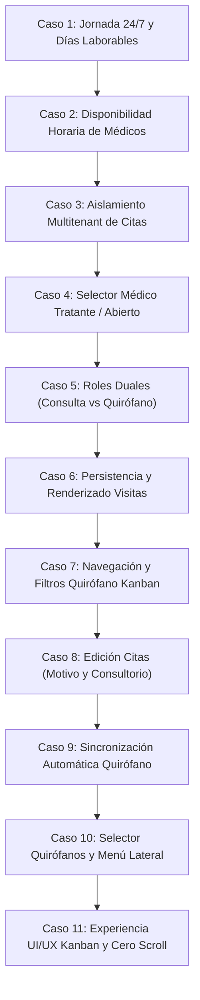

# 📋 Guion Maestro de Pruebas: Agenda Central y Quirófano Kanban

> **Ubicación Canónica**: `docs/04_standards_and_ops/guion_pruebas_agenda_quirofano.md`  
> **Versión**: `1.6.0` (Actualizado: 2026-10-21)  
> **Estado**: Activo / Reutilizable  
> **Área**: Agenda Médica, Quirófano, Expedientes y Multitenancy  

---

## 📑 Índice de Contenidos

1. [Propósito y Reglas de Mantenimiento](#1-propósito-y-reglas-de-mantenimiento)
2. [Prerrequisitos y Entorno de Ejecución](#2-prerrequisitos-y-entorno-de-ejecución)
3. [Matriz de Roles y Cuentas de Prueba](#3-matriz-de-roles-y-cuentas-de-prueba)
4. [Casos de Prueba Canónicos](#4-casos-de-prueba-canónicos)
   - [Caso 1: Jornada 24/7 y Días Laborables en Organización con CLUE](#caso-1-jornada-247-y-días-laborables-en-organización-con-clue)
   - [Caso 2: Disponibilidad Horaria de Profesionales en Agendamiento](#caso-2-disponibilidad-horaria-de-profesionales-en-agendamiento)
   - [Caso 3: Aislamiento Multitenant de Pacientes y Vista Mensual de Agenda](#caso-3-aislamiento-multitenant-de-pacientes-y-vista-mensual-de-agenda)
   - [Caso 4: Selector de Médico Tratante y Opción "Abierto" en Inscripción](#caso-4-selector-de-médico-tratante-y-opción-abierto-en-inscripción)
   - [Caso 5: Convivencia de Roles Duales (Médico Clínico vs Cirujano)](#caso-5-convivencia-de-roles-duales-médico-clínico-vs-cirujano)
   - [Caso 6: Renderizado y Persistencia de Visitas Existentes en Agenda Central](#caso-6-renderizado-y-persistencia-de-visitas-existentes-en-agenda-central)
   - [Caso 7: Navegación por Fechas y Filtros en Tablero Quirófano Kanban](#caso-7-navegación-por-fechas-y-filtros-en-tablero-quirófano-kanban)
   - [Caso 8: Edición de Citas y Recuperación de Motivo y Lugar / Consultorio](#caso-8-edición-de-citas-y-recuperación-de-motivo-y-lugar--consultorio)
   - [Caso 9: Sincronización Automática de Citas en Quirófano con el Tablero Kanban](#caso-9-sincronización-automática-de-citas-en-quirófano-con-el-tablero-kanban)
   - [Caso 10: Configuración de Quirófanos de la Organización y Visibilidad en Menú Lateral](#caso-10-configuración-de-quirófanos-de-la-organización-y-visibilidad-en-menú-lateral)
   - [Caso 11: Experiencia UI/UX Premium del Tablero Kanban, Cero Scroll Horizontal y Ficha Rápida](#caso-11-experiencia-uiux-premium-del-tablero-kanban-cero-scroll-horizontal-y-ficha-rápida)
   - [Caso 12: Gobernanza de Consentimiento NOM-004, Semáforos de Ámbito (Consulta vs Quirófano) y Repositorio Atómico](#caso-12-gobernanza-de-consentimiento-nom-004-semáforos-de-ámbito-consulta-vs-quirófano-y-repositorio-atómico)
   - [Caso 13: Checklist Preoperatorio OMS, Conteo de Seguridad y Nota Quirúrgica NOM-004 con Criterios Aldrete](#caso-13-checklist-preoperatorio-oms-conteo-de-seguridad-y-nota-quirúrgica-nom-004-con-criterios-aldrete)
   - [Caso 14: Pre-Liquidación Quirúrgica Automatizada e Inyección de Cargo a Estado de Cuenta para Cobro en Caja](#caso-14-pre-liquidación-quirúrgica-automatizada-e-inyección-de-cargo-a-estado-de-cuenta-para-cobro-en-caja)
   - [Caso 15: Trazabilidad Quirúrgica en Expediente Clínico y Formato Imprimible de Nota Quirúrgica NOM-004](#caso-15-trazabilidad-quirúrgica-en-expediente-clínico-y-formato-imprimible-de-nota-quirúrgica-nom-004)
   - [Caso 16: Vista Diaria Matricial Multi-Recurso y Popup Rápido de Inspección de Citas](#caso-16-vista-diaria-matricial-multi-recurso-y-popup-rápido-de-inspección-de-citas)
5. [Protocolo de Actualización Obligatoria](#5-protocolo-de-actualización-obligatoria)
6. [Criterios de Aceptación (Definición de Terminado)](#6-criterios-de-aceptación-definición-de-terminado)

---

## 1. Propósito y Reglas de Mantenimiento

Este documento es la **fuente única de verdad operativa** para la verificación funcional y no regresión de:
- **Agenda Central** (`views/agenda_main.pl`, `api/agenda_citas.pl`)
- **Gestión de Pacientes / Expedientes** (`views/crud_paciente.pl`, `js/paciente_form.js`, `api/pacientes_api.pl`)
- **Tablero Quirúrgico Kanban** (`views/quirofano_kanban.pl`, `api/quirofano_crud.pl`)
- **Configuración Multitenant de Negocios** (`dat/negocios_config.dat`, `dat/usuarios.dat`)

> [!IMPORTANT]
> **REGLA DE GOBERNANZA**: Este archivo **DEBE** actualizarse cada vez que se agregue, modifique o refactorice un flujo en la Agenda, Gestión de Pacientes o Quirófano Kanban. Cualquier cambio en contratos de datos o comportamiento de vistas exige registrar el nuevo caso o actualizar el caso existente antes del cierre de versión.

---

## 2. Prerrequisitos y Entorno de Ejecución

Antes de iniciar la batería de pruebas:
- **Servidor Web Activo**: Apache / XAMPP ejecutando CGI de Perl en `http://localhost/ospulso/` o dominio de pruebas.
- **Archivos de Datos Base (`dat/`)**:
  - `dat/usuarios.dat`: Usuarios delimitados por `!`.
  - `dat/negocios.dat` y `dat/negocios_config.dat`: Configuraciones de negocio por ID de empresa.
  - `dat/citas.dat` y `dat/pacientes.dat`: Catálogos de citas y pacientes con separación multitenant por `id_empresa`.
  - `dat/quirofano_cirugias.dat`: Cirugías programadas asociadas a organización.

---

## 3. Matriz de Roles y Cuentas de Prueba

| Rol | Usuario / Correo | Organización / CLUE | ID de Médico / Registro |
| :--- | :--- | :--- | :--- |
| **Administrador Organización** | `karenjimenezequihua@gmail.com` | Org `723800` (CLUE: `QTSMP000116`) | `174824106` |
| **Médico Especialista 1** | `medico1@gmail.com` (DR JONATHAN FRANCO F) | Org `723800` | `581519598` |
| **Médico Especialista 2** | `medico2@gmail.com` (DRA ANA PAOLA MENDEZ Z.) | Org `723800` | `217879461` |
| **Recepcionista** | `jaredman.cas@gmail.com` (Jared Castro) | Org `723800` | `268622241` |
| **Administrador Global** | `admin@ospulso.com` | Global (`0:0`) | `1` |

---

## 4. Casos de Prueba Canónicos

---

### Caso 1: Jornada 24/7 y Días Laborables en Organización con CLUE

* **Objetivo**: Garantizar que una organización con jornada continua 24/7 (todos los días hábiles) no muestre días marcados falsamente como "No laborable" (ej. domingos) en la Agenda Central.
* **Componentes Involucrados**:
  - [views/agenda_main.pl](file:///c:/xampp/htdocs/ospulso/views/agenda_main.pl)
  - [dat/negocios_config.dat](file:///c:/xampp/htdocs/ospulso/dat/negocios_config.dat)
* **Pasos de Ejecución**:
  1. Iniciar sesión con un usuario de la organización `723800` (ej. `Ana Karen Jimenez Equihua`).
  2. Navegar a `views/agenda_main.pl`.
  3. Abrir el modal **Ajustes de Agenda** y verificar que los días lunes a domingo estén configurados como laborables.
  4. Revisar la cuadrícula mensual y semanal de FullCalendar.
* **Resultado Esperado**:
  - Ningún día de la semana debe mostrar franjas grises ni textos de bloqueo "No laborable".
  - Todos los días deben permitir clics para agendar citas en cualquier franja horaria configurada.

---

### Caso 2: Disponibilidad Horaria de Profesionales en Agendamiento

* **Objetivo**: Asegurar que al programar citas desde roles administrativos o de recepción, se respete la jornada de los médicos y no aparezcan en horarios fuera de su disponibilidad.
* **Componentes Involucrados**:
  - [views/agenda_main.pl](file:///c:/xampp/htdocs/ospulso/views/agenda_main.pl)
  - [api/agenda_citas.pl](file:///c:/xampp/htdocs/ospulso/api/agenda_citas.pl)
* **Pasos de Ejecución**:
  1. Con rol Recepcionista o Administrador Organización, hacer clic en una celda de la Agenda Central para crear una nueva cita.
  2. En el modal de agendamiento, desplegar el selector de **Profesional Asignado**.
  3. Seleccionar a un médico específico de la organización.
* **Resultado Esperado**:
  - El selector sólo debe listar médicos autorizados de la organización activa.
  - La franja horaria sugerida debe acotarse a la disponibilidad configurada para ese profesional.

---

### Caso 3: Aislamiento Multitenant de Pacientes y Vista Mensual de Agenda

* **Objetivo**: Evitar que al crear o consultar citas se vinculen pacientes o expedientes pertenecientes a otra organización, y prevenir la polución de etiquetas erróneas en la vista mensual.
* **Componentes Involucrados**:
  - [api/agenda_citas.pl](file:///c:/xampp/htdocs/ospulso/api/agenda_citas.pl)
  - [dat/pacientes.dat](file:///c:/xampp/htdocs/ospulso/dat/pacientes.dat)
  - [dat/citas.dat](file:///c:/xampp/htdocs/ospulso/dat/citas.dat)
* **Pasos de Ejecución**:
  1. Con el usuario de la organización `723800`, buscar un paciente por nombre en el autocompletado de la cita.
  2. Verificar que los resultados pertenezcan únicamente al ID de empresa del usuario autenticado (`723800`).
  3. Guardar la cita y cambiar a la vista mensual (`Month`).
* **Resultado Esperado**:
  - La cita queda registrada con el `id_paciente` local y no de otra clínica.
  - La vista mensual renderiza el evento con su estado y color correcto sin duplicar etiquetas de bloqueo.

---

### Caso 4: Selector de Médico Tratante y Opción "Abierto" en Inscripción

* **Objetivo**: Verificar que en la inscripción/edición de pacientes ([views/crud_paciente.pl](file:///c:/xampp/htdocs/ospulso/views/crud_paciente.pl)), el selector **Médico Tratante** liste exclusivamente los médicos pertenecientes a la organización y tenga la opción `"Abierto"` seleccionada por defecto.
* **Componentes Involucrados**:
  - [views/crud_paciente.pl](file:///c:/xampp/htdocs/ospulso/views/crud_paciente.pl)
  - [js/paciente_form.js](file:///c:/xampp/htdocs/ospulso/js/paciente_form.js)
  - [dat/usuarios.dat](file:///c:/xampp/htdocs/ospulso/dat/usuarios.dat)
* **Pasos de Ejecución**:
  1. Con sesión de Administrador de Organización o Recepción de la org `723800`, entrar a `views/crud_paciente.pl` para una nueva inscripción.
  2. Localizar la tarjeta **Datos Clínicos** y el desplegable **Médico Tratante**.
  3. Inspeccionar las opciones disponibles en el selector.
  4. Guardar un nuevo paciente con la opción `"Abierto"`.
  5. Cargar el paciente recién creado en modo edición.
* **Resultado Esperado**:
  - La primera opción debe ser obligatoriamente `<option value="0" selected>Abierto</option>`.
  - La lista de doctores debe contener **únicamente** médicos de la organización `723800`:
    - `DR JONATHAN FRANCO F` (`ID: 581519598`)
    - `DRA ANA PAOLA MENDEZ ZARANDONA` (`ID: 217879461`)
  - **No** deben figurar médicos de otras clínicas (como Mario González, GERSON RAMSES, Fernando Rivas, etc.).
  - Al abrir un paciente previamente asignado a "Abierto", el select debe mantener "Abierto" sin forzar un doctor arbitrario.

---

### Caso 5: Convivencia de Roles Duales (Médico Clínico vs Cirujano)

* **Objetivo**: Asegurar que un médico que realice tanto consulta externa como intervenciones quirúrgicas pueda ser asignado a citas regulares en la Agenda Central y a procedimientos en el Quirófano.
* **Componentes Involucrados**:
  - [views/agenda_main.pl](file:///c:/xampp/htdocs/ospulso/views/agenda_main.pl)
  - [views/quirofano_kanban.pl](file:///c:/xampp/htdocs/ospulso/views/quirofano_kanban.pl)
* **Pasos de Ejecución**:
  1. Asignar al médico `581519598` a una consulta externa a las 10:00 en `agenda_main.pl`.
  2. En `quirofano_kanban.pl`, registrar una cirugía al mismo cirujano a las 14:00.
  3. Consultar ambos módulos con el filtro de cirujano/médico.
* **Resultado Esperado**:
  - Ambos flujos coexisten sin sobreescritura de expedientes ni colisión de roles en `usuarios.dat`.

---

### Caso 6: Renderizado y Persistencia de Visitas Existentes en Agenda Central

* **Objetivo**: Comprobar que todas las citas activas de la organización se lean de `dat/citas.dat`, se serialicen en el endpoint `api/agenda_citas.pl` y se pinten en FullCalendar sin omisiones tras recargar la página.
* **Componentes Involucrados**:
  - [views/agenda_main.pl](file:///c:/xampp/htdocs/ospulso/views/agenda_main.pl)
  - [api/agenda_citas.pl](file:///c:/xampp/htdocs/ospulso/api/agenda_citas.pl)
  - [dat/citas.dat](file:///c:/xampp/htdocs/ospulso/dat/citas.dat)
* **Pasos de Ejecución**:
  1. Entrar a `views/agenda_main.pl`.
  2. Verificar la carga inicial de citas en la semana corriente.
  3. Navegar hacia adelante o atrás de semana y regresar.
  4. Recargar el navegador (`F5` o `Ctrl+F5`).
* **Resultado Esperado**:
  - Todas las citas de la organización se muestran en sus respectivos horarios y estados (`Programada`, `Confirmada`, `Atendida`, etc.).
  - No hay errores de consola JS (`SyntaxError` o excepciones de renderizado).

---

### Caso 7: Navegación por Fechas y Filtros en Tablero Quirófano Kanban

* **Objetivo**: Validar la barra interactiva de navegación y filtrado del Tablero Kanban de Quirófano para permitir la exploración cuando no haya cirugías hoy, filtrado por cirujano y búsqueda dinámica de paciente o procedimiento.
* **Componentes Involucrados**:
  - [views/quirofano_kanban.pl](file:///c:/xampp/htdocs/ospulso/views/quirofano_kanban.pl)
  - [api/quirofano_crud.pl](file:///c:/xampp/htdocs/ospulso/api/quirofano_crud.pl)
  - [dat/quirofano_cirugias.dat](file:///c:/xampp/htdocs/ospulso/dat/quirofano_cirugias.dat)
* **Pasos de Ejecución**:
  1. Abrir `views/quirofano_kanban.pl`.
  2. **Verificación de Fecha por Defecto**:
     - Constatar que el input `#filtroFecha` tiene la fecha actual y la etiqueta superior muestra el día formateado (ej. `MIÉ, 21 OCT 2026`).
  3. **Navegación de Fechas**:
     - Hacer clic en `◀` (Día Anterior) y verificar que la fecha retrocede 1 día y refresca las columnas.
     - Hacer clic en `▶` (Día Siguiente) y verificar que avanza 1 día.
     - Hacer clic en `Hoy` y verificar que vuelve inmediatamente a la fecha actual del sistema.
     - Cambiar la fecha manualmente en el calendario nativo (`<input type="date">`).
  4. **Filtro por Cirujano**:
     - Desplegar el selector **Cirujano / Especialista**.
     - Seleccionar a un cirujano específico (ej. `DR JONATHAN FRANCO F`).
     - Constatar que solo permanecen visibles las tarjetas de ese cirujano y los contadores numéricos de cada columna se actualizan en tiempo real.
     - Volver a seleccionar `👨‍⚕️ Todos los Médicos / Cirujanos` y confirmar que reaparecen todas las tarjetas.
  5. **Búsqueda por Paciente o Procedimiento**:
     - Escribir en el campo de texto el nombre parcial de un paciente (ej. `marisol`) o un procedimiento (ej. `apendicectomía`).
     - Verificar que el botón de limpieza `[X]` aparece y las tarjetas se filtran instantáneamente mientras se escribe.
     - Pulsar el botón `[X]` y confirmar que el filtro se limpia y se restauran las tarjetas.
  6. **Estado Vacío Amigable**:
     - Navegar a una fecha en la que no existan cirugías programadas.
     - Verificar que las columnas vacías muestran el indicador sutil `Sin cirugías` sin desbordar ni colapsar el diseño.
  6. **Estado Vacío Amigable**:
     - Navegar a una fecha en la que no existan cirugías programadas.
     - Verificar que las columnas vacías muestran el indicador sutil `Sin cirugías` sin desbordar ni colapsar el diseño.
  7. **Arrastrar y Soltar (Drag & Drop)**:
     - Mover una tarjeta entre columnas (ej. de `Programada` a `Pre-Operatorio` o `En Quirófano`).
     - Verificar que el estado se actualiza en el backend y el contador numérico de ambas columnas se refresca.
* **Resultado Esperado**:
  - La navegación es 100% fluida, sin necesidad de recargar la página completa.
  - La barra de filtros permite al personal clínico revisar cirugías de días anteriores, presentes y futuros de forma inmediata.

---

### Caso 8: Edición de Citas, Recuperación de Datos y Resaltado de Horario en Amarillo Avena

* **Objetivo**: Asegurar que al abrir el modal para editar una cita existente en la Agenda Central:
  1. Se resalte en el **título del modal** la **fecha y hora de inicio** de la cita con una insignia de alta visibilidad y contraste (`badge-avena-highlight`).
  2. En el panel derecho, bajo **Duración Estimada**, se exhiba con un **color suave amarillo avena** (`#FEF9C3` / borde `#FDE68A` / texto `#78350F`) el **bloqueo de ese horario aproximado** (`#bloqueo-horario-avena`), activando el botón de duración correspondiente (`.dur-avena-active`) y marcando el slot actual (`.dur-avena-slot`).
  3. Los campos **Motivo / Observaciones** (`#f_motivo`) y **Lugar / Consultorio** (`#f_consultorio`) se recuperen e hidraten fielmente sin perderse por llamadas asíncronas secundarias.
* **Componentes Involucrados**:
  - [views/agenda_main.pl](file:///c:/xampp/htdocs/ospulso/views/agenda_main.pl)
  - [js/agenda_spa_new.js](file:///c:/xampp/htdocs/ospulso/js/agenda_spa_new.js)
  - [css/ospulso_master_v2.css](file:///c:/xampp/htdocs/ospulso/css/ospulso_master_v2.css)
  - [api/citas_crud.pl](file:///c:/xampp/htdocs/ospulso/api/citas_crud.pl)
* **Pasos de Ejecución**:
  1. Ingresar a `views/agenda_main.pl` con la cuenta de la organización o médico.
  2. Localizar una cita agendada en la vista de calendario y hacer clic para abrirla en modo edición.
  3. Verificar el **Título del Modal** (`#modalCitaTitle`): debe mostrar la etiqueta del estado o edición acompañada de la insignia dorada con el calendario y la hora de inicio (ej. `<i class="bi bi-calendar3"></i> 22 Oct 2026 • <i class="bi bi-clock-fill"></i> 10:00 hrs`).
  4. Inspeccionar la sección **Duración Estimada** en el panel derecho:
     - Debe desplegarse el contenedor `#bloqueo-horario-avena` con fondo suave amarillo avena (`#FEF9C3`), icono de candado ámbar y rango de horario aproximado bloqueado (ej. `10:00 - 10:30 hrs (30 min)`).
     - El botón de duración correspondiente (ej. `30m` o `1h`) debe estar marcado con estilo avena activo (`.dur-avena-active`).
     - En la grilla de horarios disponibles, el bloque del horario asignado debe reflejarse como activo (`.dur-avena-slot`).
  5. Al hacer clic en un slot diferente, comprobar que el título del modal y el contenedor de bloqueo se recalculan reactivamente con el nuevo horario seleccionado.
  6. Revisar el valor mostrado en `#f_motivo` y `#f_consultorio`.
  7. Modificar los datos y hacer clic en **Guardar Cita**.
* **Resultado Esperado**:
  - Título del modal resalta fecha y hora de inicio de forma elegante, nítida y legible.
  - La duración estimada comunica de inmediato el bloqueo horario aproximado en color suave amarillo avena sin desbordar el modal.
  - Al cambiar de horario o fecha, el bloqueo horario aproximado y el título se actualizan en tiempo real.
  - El motivo y consultorio originales se preservan y persisten correctamente tras guardar.

---

### Caso 9: Sincronización Automática de Citas en Quirófano con el Tablero Kanban

* **Objetivo**: Verificar que al agendar o actualizar una cita en la Agenda Central asignándole un recurso quirúrgico (`Quirófano 1`, `Quirófano 2`), el registro se sincronice automáticamente en `dat/quirofano.dat` y se renderice en el Tablero Kanban de Quirófano.
* **Componentes Involucrados**:
  - [views/agenda_main.pl](file:///c:/xampp/htdocs/ospulso/views/agenda_main.pl)
  - [api/citas_crud.pl](file:///c:/xampp/htdocs/ospulso/api/citas_crud.pl)
  - [views/quirofano_kanban.pl](file:///c:/xampp/htdocs/ospulso/views/quirofano_kanban.pl)
  - [dat/quirofano.dat](file:///c:/xampp/htdocs/ospulso/dat/quirofano.dat)
* **Pasos de Ejecución**:
  1. En `views/agenda_main.pl`, abrir el modal para agendar una nueva cita para hoy a las 11:00.
  2. Seleccionar un paciente, médico cirujano, motivo (ej. `Hernioplastia umbilical`) y en **Lugar / Consultorio** elegir `Quirófano 1`.
  3. Guardar la cita.
  4. Abrir en otra pestaña `views/quirofano_kanban.pl` para el día de hoy.
  5. Verificar la presencia de la tarjeta quirúrgica en la columna **Programada**.
  6. En la Agenda Central, cambiar el horario o motivo de la cita y verificar que el Kanban refleja la modificación.
  7. Cancelar o eliminar la cita en la Agenda y verificar que desaparece de `quirofano_kanban.pl`.
* **Resultado Esperado**:
  - Toda cita con recurso "Quirófano" alimenta directamente `dat/quirofano.dat` sin intervención manual ni duplicidad de agendamiento.
  - El Tablero Kanban renderiza la tarjeta con el paciente, médico, procedimiento, hora y sala correctos.

---

### Caso 10: Configuración de Quirófanos de la Organización y Visibilidad en Menú Lateral

* **Objetivo**: Validar que la cantidad de quirófanos de la organización se configure mediante un selector formal en Gestión de Sucursales (`views/manage_clinicas.pl`) y que, como regla mandatoria, si una organización carece de quirófanos (0 quirófanos), la opción "Tablero Quirófano" se oculte automáticamente del menú lateral izquierdo.
* **Componentes Involucrados**:
  - [views/manage_clinicas.pl](file:///c:/xampp/htdocs/ospulso/views/manage_clinicas.pl)
  - [api/crud_sucursales_api.pl](file:///c:/xampp/htdocs/ospulso/api/crud_sucursales_api.pl)
  - [utils/sub_sidebar.pl](file:///c:/xampp/htdocs/ospulso/utils/sub_sidebar.pl)
  - [dat/negocios_config.dat](file:///c:/xampp/htdocs/ospulso/dat/negocios_config.dat)
* **Pasos de Ejecución**:
  1. Iniciar sesión como Administrador de Organización y navegar a `views/manage_clinicas.pl`.
  2. Abrir el formulario para registrar o editar una sucursal.
  3. Comprobar que el campo de quirófanos es un selector desplegable con opciones de `0` a `10` quirófanos.
  4. **Prueba de Ocultamiento (0 Quirófanos)**:
     - Configurar la sucursal en `0 Quirófanos (Sin quirófano)` y guardar.
     - Recargar la página e inspeccionar el menú lateral izquierdo (`utils/sub_sidebar.pl`).
     - Confirmar que el enlace **Tablero Quirófano** **NO** aparece en el menú lateral.
  5. **Prueba de Habilitación (1+ Quirófanos)**:
     - Modificar la sucursal asignándole `2 Quirófanos` y guardar.
     - Recargar la página e inspeccionar el menú lateral.
     - Confirmar que el enlace **Tablero Quirófano** aparece activo y accesible.
* **Resultado Esperado**:
  - El selector permite definir con exactitud la capacidad quirúrgica de la clínica.
  - La regla de negocio del menú lateral respeta estrictamente la existencia de quirófanos (`QUIROFANOS > 0`).

---

### Caso 11: Experiencia UI/UX Premium del Tablero Kanban, Cero Scroll Horizontal y Ficha Rápida

* **Objetivo**: Comprobar que en pantallas de escritorio o laptops estándar ($\ge 1100\text{px}$) el Tablero Kanban renderiza sus 5 columnas clínicas en CSS Grid fluido sin ningún scroll horizontal, desplegando la barra de KPIs ejecutivos, tarjetas con monogramas de paciente, indicadores de pulso en vivo para cirugías en curso y el Modal de Inspección Rápida con transiciones de 1 clic.
* **Componentes Involucrados**:
  - [views/quirofano_kanban.pl](file:///c:/xampp/htdocs/ospulso/views/quirofano_kanban.pl)
  - [api/quirofano_crud.pl](file:///c:/xampp/htdocs/ospulso/api/quirofano_crud.pl)
  - [css/sdm_mobile_standards.css](file:///c:/xampp/htdocs/ospulso/css/sdm_mobile_standards.css)
* **Pasos de Ejecución**:
  1. Abrir `views/quirofano_kanban.pl` en una pantalla de escritorio (1280px, 1366px, 1920px).
  2. **Verificación de Cero Scroll Horizontal**:
     - Inspeccionar visualmente la ventana y la barra de desplazamiento del navegador.
     - Constatar que **NO** existe barra de scroll horizontal en el contenedor `.kanban-board`. Las 5 columnas (`Programada`, `Pre-Operatorio`, `En Quirófano`, `Recuperación`, `Alta / Traslado`) ocupan simétricamente el 100% del ancho útil.
  3. **Verificación de Barra de KPIs Ejecutivos**:
     - Constatar los chips superiores con conteos del día: `Total`, `Programadas`, `Pre-Op`, `En Quirófano` (con halo pulsante rojo), `Recuperación` y `Concluidas`.
     - Verificar que la suma de los estados coincide con el `Total`.
  4. **Inspección de Tarjetas Clínicas**:
     - Verificar que cada tarjeta muestra la píldora de hora (`HH:MM`), sala quirúrgica, monograma circular con iniciales del paciente, nombre del paciente, procedimiento con badge suave y equipo quirúrgico (Cirujano y Anestesiólogo).
     - Comprobar que el borde izquierdo de la tarjeta (`border-left`) tiene el color identitario de su columna.
  5. **Modal de Ficha Rápida e Inspección Quirúrgica (Diseño Compacto y Alto Contraste)**:
     - Hacer clic sobre una tarjeta quirúrgica.
     - Confirmar que se abre el modal `#modalDetalleCirugia` con diseño ergonómico compacto (`.modal-qx-compact`, max-width 820px en lugar de 1140px):
       - Header con degradado Medentia Aura (`#0A2A66` a `#124A9E`), acento turquesa clínico (`#19B7A5`) y tipografía blanca de alto contraste con subtítulo en oro/acento legible.
       - Cuerpo del modal con fondo clínico tenue (`#F8FBFF`) y altura máxima calculada (`calc(85vh - 110px)`) para evitar scroll de ventana.
       - Barra de navegación quirúrgica (`.nav-pills-qx`) con pestañas compactas y de alto contraste.
       - Sub-tarjetas clínicas (`.qx-subcard`) con bordes turquesa sutiles, micro-etiquetas en gris pizarra (`#475569`) y valores legibles en azul noche (`#0f172a`).
       - Resumen del procedimiento, sala, horario, semáforo de consentimiento NOM-004, cirujano y anestesiólogo.
       - Botón directo para "Abrir Expediente" clínico.
       - Botones de **Transición Rápida de Estado** (ej. "Mover a En Quirófano", "Mover a Recuperación", "Mover a Alta").
     - Hacer clic en uno de los botones de transición y verificar que el modal se cierra, la tarjeta se mueve de columna automáticamente y el toast de éxito se despliega.
  6. **Comportamiento Táctil / Responsivo (<1100px)**:
     - Reducir el ancho del navegador o activar el modo dispositivo móvil de las Developer Tools.
     - Verificar que el tablero activa un deslizamiento horizontal táctil con snap suave (`scroll-snap-type: x mandatory`), manteniendo un ancho mínimo cómodo (280px) por columna sin desbordamiento destructivo de texto.
* **Resultado Esperado**:
  - Cero scroll horizontal en resoluciones de escritorio.
  - Experiencia ejecutiva, profesional y fluida para el personal médico, circulantes y anestesiólogos.

---

### Caso 12: Gobernanza de Consentimiento NOM-004, Semáforos de Ámbito (Consulta vs Quirófano) y Repositorio Atómico

* **Objetivo**: Validar el ciclo de vida integral de los consentimientos informados bajo la NOM-004-SSA3-2012, asegurando: (1) discriminación de ámbito de uso (`USO_CONSULTA` vs `USO_QUIROFANO`), (2) semaforización de estado de consumo (🟢 *Utilizado* vs 🟡 *Disponible*), (3) renderizado tabular en Paso 5 de Consulta Privada sin duplicidad de campos, (4) visualización del semáforo quirúrgico en el Tablero Quirófano Kanban, y (5) persistencia HTTP robusta sin errores 500 de CGI en Apache.
* **Componentes Involucrados**:
  - [views/partials/consultas/step_registro_privado.pl](file:///c:/xampp/htdocs/ospulso/views/partials/consultas/step_registro_privado.pl)
  - [views/partials/consultas/step_comunicacion.pl](file:///c:/xampp/htdocs/ospulso/views/partials/consultas/step_comunicacion.pl)
  - [views/render_consultas_privado.pl](file:///c:/xampp/htdocs/ospulso/views/render_consultas_privado.pl)
  - [views/quirofano_kanban.pl](file:///c:/xampp/htdocs/ospulso/views/quirofano_kanban.pl)
  - [views/render_expediente_clinico.pl](file:///c:/xampp/htdocs/ospulso/views/render_expediente_clinico.pl)
  - [api/consentimientos_api.pl](file:///c:/xampp/htdocs/ospulso/api/consentimientos_api.pl)
  - [api/cerrar_consulta_privado.pl](file:///c:/xampp/htdocs/ospulso/api/cerrar_consulta_privado.pl)
  - [dat/consentimientos/](file:///c:/xampp/htdocs/ospulso/dat/consentimientos/)
* **Pasos de Ejecución**:
  1. **Inicio de Consulta en Wizard Clínico**:
     - Abrir el Wizard de Consulta Privada (`views/render_consultas_privado.pl?id_paciente=<id>`).
     - En el **Paso 0 (Registro de Consulta)**, localizar la tarjeta de documentación legal: *"¿Requiere Consentimientos & doc legales para esta consulta?"* (`#check_requiere_consentimiento_registro`).
  2. **Verificación de Inhabilitación Reactiva (Flujo de Rutina)**:
     - Desactivar el interruptor (estado `OFF` / Desmarcado).
     - Avanzar al **Paso 5 (Acuerdos / Comunicación)**.
     - Constatar que el contenedor `#seccion-consentimiento-container` se contrae automáticamente y despliega el aviso informativo: *"Documentación Legal Inhabilitada para esta Consulta - Has indicado en el Paso 0 que esta consulta prescinde de consentimientos legales..."*.
     - Confirmar que el botón *"Habilitar Documentación Legal para esta Consulta"* reactiva inmediatamente el bloque si el médico lo decide.
  3. **Tabla Dinámica de Consentimientos en Paso 5 (`USO_CONSULTA`)**:
     - Con el switch en `ON`, verificar que el Paso 5 renderiza la tabla interactiva `#tablaConsentimientosWizard` filtrada exclusivamente por `ambito=USO_CONSULTA`.
     - Constatar que cada renglón muestra:
       - Folio y Tipo de Consentimiento.
       - Diagnóstico y Procedimiento.
       - Fecha de emisión y Médico firmante.
       - **Semáforo de Uso**: 🟢 *Utilizado* (si ya fue consumido en una consulta cerrada) o 🟡 *Disponible* (listo para vincular).
       - Botón de Acción: *"Vincular a esta Consulta"* (guarda el `id_consentimiento` en `#id_consentimiento_vinculado`).
  4. **Emisión In Situ desde Wizard con Modal Compacto**:
     - En Paso 5, pulsar el botón `+ Emitir Nuevo Consentimiento`.
     - Constatar que abre el modal compacto `#modalNuevoConsentimientoWizard` con diseño ergonómico de 640px y sin scroll vertical estorboso.
     - Firmar en el pad táctil con trazo fluido y presionar *"Firmar y Guardar Documento"*.
     - Constatar que la petición viaja con `Content-Type: application/x-www-form-urlencoded`, respondiendo `200 OK` (cero errores 500 de CGI).
     - Verificar que el nuevo consentimiento se añade automáticamente a la tabla con semáforo 🟡 *Disponible* y queda preseleccionado.
  5. **Cierre de Consulta y Consumo Atómico de Semáforo**:
     - Avanzar al cierre de consulta en `api/cerrar_consulta_privado.pl`.
     - Constatar que el consentimiento vinculado transiciona atómicamente a `utilizado = 1` y almacena el `id_consulta`.
  6. **Expediente Clínico (Pestaña 11) y Selector de Ámbito**:
     - Abrir el Expediente Clínico del paciente (`views/render_expediente_clinico.pl?id_paciente=<id>#tab-11`).
     - Hacer clic en el botón *"Nuevo Consentimiento"*.
     - Verificar los radio-pills de ámbito:
       - 🩺 **Uso en Consulta** (`USO_CONSULTA`): Orientado a procedimientos de consultorio.
       - 🏥 **Uso en Quirófano** (`USO_QUIROFANO`): Orientado a cirugías mayores, sedaciones y anestesia.
     - Registrar un consentimiento marcado con **Uso en Quirófano**.
     - Comprobar que en la tabla `#tablaConsentimientosHub` se muestran las columnas de **Ámbito** y **Semáforo** (🟢 Utilizado / 🟡 Disponible).
  7. **Inspección de Semáforo Quirúrgico en Quirófano Kanban**:
     - Abrir el Tablero Quirófano Kanban (`views/quirofano_kanban.pl`).
     - Hacer clic en una cirugía del paciente para abrir la **Ficha Rápida** (`#modalDetalleCirugia`).
     - Constatar que el bloque *"Consentimiento Quirúrgico (NOM-004)"* consulta asíncronamente los consentimientos con `ambito=USO_QUIROFANO`:
       - Si existe firmado: muestra badge 🟢 *Firmado (NOM-004)* + Semáforo de Sala (🟢 *Utilizado* o 🟡 *Disponible*) y botón *"Ver Doc"*.
       - Si falta firma: muestra badge 🟡 *Pendiente de Firma* con botón de enlace directo al expediente.
       - Si no existe: muestra badge 🔴 *Sin Consentimiento Qx* con botón *"Emitir"*.
     - Al presionar *"Ver Doc"*, se despliega el resumen con diagnóstico, procedimiento y firmas gráficas autenticadas.
* **Resultado Esperado**:
  - Trazabilidad legal 100% clara y diferenciada entre la consulta externa y el quirófano.
  - Semáforos visuales (🟢 / 🟡 / 🔴) que impiden operar sin consentimiento previo firmado.
  - Modales compactos de alto contraste con firma táctil sensible y cero desbordamientos.
  - Comunicación HTTP fluida y robusta sin fallas de tamaño o cortes de socket CGI en Apache.

---

### Caso 13: Checklist Preoperatorio OMS, Conteo de Seguridad y Nota Quirúrgica NOM-004 con Criterios Aldrete

* **Objetivo**: Validar el flujo clínico transoperatorio completo en el Modal Quirúrgico (`#modalDetalleCirugia`): (1) Verificación preoperatoria de 8 puntos según la OMS (Safe Surgery), (2) Registro cronológico de tiempos quirúrgicos e integridad del conteo de seguridad (gasas, compresas e instrumental al 100%), (3) Hoja de Técnica Quirúrgica obligatoria según la NOM-004-SSA3-2012, y (4) Evaluación reactiva de los Criterios de Recuperación UCPA (Escala de Aldrete de 0 a 10 puntos) con dictamen automático de alta.
* **Componentes Involucrados**:
  - [views/quirofano_kanban.pl](file:///c:/xampp/htdocs/ospulso/views/quirofano_kanban.pl)
  - [api/quirofano_crud.pl](file:///c:/xampp/htdocs/ospulso/api/quirofano_crud.pl)
  - `dat/quirofano/cirugia_<id>.json`
* **Pasos de Ejecución**:
  1. **Apertura de la Ficha Quirúrgica**:
     - En `views/quirofano_kanban.pl`, hacer clic sobre cualquier tarjeta de cirugía para abrir el modal `#modalDetalleCirugia`.
  2. **Checklist OMS Pre-Op (Pestaña 2)**:
     - Cambiar a la pestaña **2. Checklist OMS Pre-Op**.
     - Activar los switches interactivos:
       - Identidad confirmada con 2 identificadores.
       - Consentimiento Qx y anestésico verificado.
       - Sitio quirúrgico marcado por cirujano.
       - Alergias a fármacos verificadas.
       - Ayuno confirmado (especificando horas, ej: 8 hrs).
       - Laboratorios validados (TP/TTP/Hb/Rh).
       - Vía venosa periférica permeable.
       - Profilaxis antibiótica (<60 min).
     - Añadir observaciones de enfermería y presionar *"Guardar Checklist Pre-Op"*.
     - Constatar la respuesta exitosa y persistencia en `cirugia_<id>.json`.
  3. **Tiempos Quirúrgicos y Conteo de Seguridad (Pestaña 3)**:
     - Cambiar a la pestaña **3. Nota Quirúrgica & UCPA**.
     - Registrar los tiempos: Ingreso Sala, Inicio Anestesia, Incisión Qx, Cierre de Piel y Salida a UCPA.
     - Activar los switches de seguridad: *Conteo de Gasas Verificado (100%)*, *Conteo de Compresas Verificado (100%)* y *Conteo de Instrumental Completo*.
  4. **Nota Quirúrgica NOM-004**:
     - Capturar Diagnóstico Pre y Postoperatorio, Operación Realizada, Descripción detallada de la Técnica Quirúrgica, Hallazgos, Sangrado aproximado (ml) y Piezas enviadas a Patología.
  5. **Evaluación de Aldrete UCPA y Badge Reactivo**:
     - Ajustar los 5 selectores de la Escala de Aldrete (Actividad, Respiración, Circulación/PA, Conciencia y Saturación de $O_2$).
     - Comprobar que si la suma es $\ge 9$, el badge se torna verde: `🟢 X / 10 Pts (Apto para Alta)`.
     - Si la suma cae por debajo de 9, el badge cambia reactivamente a amarillo/naranja: `🟡 X / 10 Pts (En Recuperación)`.
     - Presionar *"Guardar Nota Quirúrgica y Aldrete"*.
     - Confirmar que al recargar el modal los datos permanecen fidedignos e hidratados.
* **Resultado Esperado**:
  - Blindaje médico-legal total conforme a la NOM-004-SSA3-2012 y protocolos OMS.
  - Almacenamiento desacoplado en el dossier atómico sin alterar el rendimiento del tablero general.

---

### Caso 14: Pre-Liquidación Quirúrgica Automatizada e Inyección de Cargo a Estado de Cuenta para Cobro en Caja

* **Objetivo**: Asegurar la rentabilidad clínica y el cierre financiero del paciente vinculando el quirófano con el módulo financiero: (1) Computar tiempo en sala quirófano por tarifa horaria, (2) Honorarios de cirujano y anestesiólogo, (3) Tabla dinámica de insumos y materiales utilizados, y (4) Transmitir un cargo formal no duplicable hacia `dat/estado_cuenta.dat` para su cobro inmediato en Caja.
* **Componentes Involucrados**:
  - [views/quirofano_kanban.pl](file:///c:/xampp/htdocs/ospulso/views/quirofano_kanban.pl)
  - [api/quirofano_crud.pl](file:///c:/xampp/htdocs/ospulso/api/quirofano_crud.pl)
  - [dat/estado_cuenta.dat](file:///c:/xampp/htdocs/ospulso/dat/estado_cuenta.dat)
  - [views/finanzas.pl](file:///c:/xampp/htdocs/ospulso/views/finanzas.pl)
* **Pasos de Ejecución**:
  1. **Acceso a la Pestaña Financiera**:
     - En el modal de la cirugía, ingresar a la pestaña **4. Pre-Liquidación & Caja**.
  2. **Configuración de Tiempos y Honorarios**:
     - Modificar las horas de sala (ej. 2.0 hrs) y el costo horario (ej. $1,500.00).
     - Ingresar honorarios de Cirujano (ej. $5,000.00) y Anestesiólogo (ej. $2,500.00).
  3. **Tabla Dinámica de Insumos**:
     - Hacer clic en `+ Agregar Insumo`.
     - Agregar renglones personalizados (ej. "Sutura Vicryl 2-0", "Solución Fisiológica 1000ml", "Kit Laparoscopía").
     - Modificar cantidades y precios unitarios.
     - Constatar que el total de liquidación (`#lbl_total_liquidacion`) se recalcula en tiempo real al cambiar cualquier celda.
     - Probar el botón de eliminar fila (`🗑️`) y comprobar la deducción inmediata del total.
  4. **Guardar Borrador**:
     - Presionar *"Guardar Borrador"*. Constatar que el dossier se actualiza sin generar cargos en Caja aún.
  5. **Inyección Canónica a Caja**:
     - Hacer clic en el botón *"Enviar a Caja"*.
     - Confirmar el diálogo de SweetAlert2.
     - Verificar la respuesta exitosa: el badge cambia a `🟢 Inyectado a Caja (MOV-...)` y el botón se desactiva con la leyenda *"Ya en Caja"*.
     - Comprobar que en `dat/estado_cuenta.dat` se inserta la línea `Cargo` con el desglose del procedimiento, identificador de cirugía y monto total exacto al centavo.
  6. **Recepción en Módulo de Caja**:
     - Abrir `views/finanzas.pl` y verificar que en el estado de cuenta del paciente aparece el nuevo cargo quirúrgico listo para emitir el recibo de cobro.
* **Resultado Esperado**:
  - Cero fuga de ingresos por insumos de quirófano.
  - Integridad contable bidireccional entre la sala de operaciones y la ventanilla de cobranza sin duplicar movimientos ni requerir recapturas manuales.

---

### Caso 15: Trazabilidad Quirúrgica en Expediente Clínico y Formato Imprimible de Nota Quirúrgica NOM-004

* **Objetivo**: Asegurar la continuidad asistencial del paciente integrando el historial quirúrgico completo en el Expediente Clínico ([views/render_expediente_clinico.pl](file:///c:/xampp/htdocs/ospulso/views/render_expediente_clinico.pl)#tab12) y facilitando la exportación/impresión inmediata de la Hoja Quirúrgica Oficial según la NOM-004-SSA3-2012 y NOM-006-SSA3-2011 ([views/imprimir_nota_quirurgica.pl](file:///c:/xampp/htdocs/ospulso/views/imprimir_nota_quirurgica.pl)).
* **Componentes Involucrados**:
  - [views/render_expediente_clinico.pl](file:///c:/xampp/htdocs/ospulso/views/render_expediente_clinico.pl) (`#tab12`)
  - [views/imprimir_nota_quirurgica.pl](file:///c:/xampp/htdocs/ospulso/views/imprimir_nota_quirurgica.pl)
  - [views/quirofano_kanban.pl](file:///c:/xampp/htdocs/ospulso/views/quirofano_kanban.pl)
  - [utils/sub_sidebar.pl](file:///c:/xampp/htdocs/ospulso/utils/sub_sidebar.pl)
  - [api/quirofano_crud.pl](file:///c:/xampp/htdocs/ospulso/api/quirofano_crud.pl)
* **Pasos de Ejecución**:
  1. **Navegación al Expediente del Paciente**:
     - Abrir el Expediente Clínico de un paciente con cirugías previas (`views/render_expediente_clinico.pl?id=6`).
     - Localizar en el menú lateral de la sección Expediente la opción: **Quirófano & Cirugías** (`tab12`).
     - Hacer clic en el enlace y constatar la transición reactiva a la pestaña `#tab12`.
  2. **Inspección de KPIs e Historial Quirúrgico**:
     - Verificar que los contadores superiores computen: `Total de Cirugías`, `Cirugías Realizadas / Alta` y `En Programación / Activas`.
     - Constatar que la tabla `#tablaCirugiasExpediente` lista las cirugías del paciente con:
       - Folio QX
       - Fecha y Horario
       - Procedimiento Quirúrgico y notas
       - Sala de operaciones asignada
       - Cirujano titular y Anestesiólogo
       - Badge semafórico de estado (`Programada`, `Pre-Op`, `En Sala Qx`, `En UCPA`, `Concluida`)
  3. **Impresión de Nota Quirúrgica NOM-004 desde Expediente**:
     - En la columna de Acciones de la tabla, hacer clic en el botón `🖨️` (*Imprimir Nota Quirúrgica NOM-004*).
     - Comprobar que se abre una nueva pestaña con `views/imprimir_nota_quirurgica.pl?id_cirugia=<id>`.
     - Validar que el formato imprimible incluye:
       - Membrete formal con nombre de clínica y CLUE.
       - Datos del paciente (CURP, edad, sexo, sangre, alergias).
       - Equipo quirúrgico completo (Cirujano, Ayudante, Anestesiólogo, Instrumentista, Circulante).
       - Protocolo Safe Surgery OMS verificado y tiempos de sala.
       - Técnica quirúrgica detallada, hallazgos, sangrado y patología.
       - Criterios de Aldrete UCPA (puntaje sobre 10) y estatus de alta.
       - Espacios de firmas oficiales para Cirujano y Anestesiólogo.
  4. **Impresión Directa desde el Tablero Quirófano Kanban**:
     - En `views/quirofano_kanban.pl`, abrir el modal de una cirugía y navegar a la pestaña **3. Nota Quirúrgica & UCPA**.
     - Comprobar la presencia del botón `🖨️ Imprimir Nota NOM-004`.
     - Hacer clic y verificar que carga la hoja de impresión con los datos actualizados de la intervención.
* **Resultado Esperado**:
  - El expediente clínico ofrece un registro histórico completo y unificado de todas las intervenciones del paciente.
  - Cero desconexión entre la sala de quirófano y el archivo clínico central.
  - Generación instantánea de notas médicas legales listas para firma física, auditoría o archivo digital.

---

### Caso 16: Vista Diaria Matricial Multi-Recurso y Popup Rápido de Inspección de Citas

* **Objetivo**: Proveer una experiencia de alta densidad y agilidad operativa en la vista diaria de la Agenda (`views/agenda_main.pl`), distribuyendo la jornada en una matriz horizontal de columnas dinámicas por recurso físico (Consultorios y Quirófanos) o profesional médico, con agendamiento por clic en celdas y un modal intermedio ágil (`#appointmentQuickModal`) para previsualización y acciones directas.
* **Actores**: Recepción, Coordinador Médico, Médicos Especialistas y Cirujanos.
* **Componentes Involucrados**:
  - `views/agenda_main.pl` (Toolbar multi-recurso `#dia-resource-toolbar`, `#appointmentQuickModal`).
  - `css/ospulso_master_v2.css` (Clases de matriz `.dia-matrix-card`, `.dia-matrix-responsive`, `.dia-matrix-table`, headers estilizados `.dia-col-consultorio`, `.dia-col-quirofano`, `.dia-col-medico` y estilos del popup rápido).
  - `js/agenda_spa_new.js` (Funciones `renderTimeline()`, `setDiaViewMode()`, `setDiaFilterActive()`, `handleMatrixSlotClick()`, `openAppointmentQuickDetail()`, `renderMatrixAptCard()`).
* **Pasos de Ejecución**:
  1. **Navegación a la Vista de Día**:
     - Entrar a la Agenda Central (`views/agenda_main.pl`).
     - Seleccionar el selector de vista **DÍA** (botón `#btn-v-dia` o navegación directa a fecha).
  2. **Alternancia de Modo en Barra de Distribución**:
     - Localizar la barra superior `#dia-resource-toolbar`.
     - Presionar el botón **"Espacios Físicos"**: la matriz genera columnas para cada Consultorio (1..N) y Quirófano (1..N) configurados en la sucursal activa (`window.sucursalRecursos`), identificando consultorios con tono Verde Azulado (`#19B7A5`) y quirófanos con Púrpura Quirúrgico (`#7C3AED`).
     - Presionar el botón **"Profesionales"**: la matriz se reconfigura dinámicamente desplegando columnas por cada médico activo con consultas en la jornada (`#f_medico_select`), identificadas con Azul Profundo (`#0A2A66`).
  3. **Filtrado por Pills de Columna**:
     - Hacer clic en los selectores tipo pill (`[Todos]`, `[Cons 1]`, `[Quirófano 1]`, etc.).
     - Constatar que la tabla filtra de inmediato la columna seleccionada, permitiendo aislar un recurso específico o restaurar la cuadrícula completa con `[Todos]`.
  4. **Agendamiento Rápido por Celda**:
     - En una celda horaria vacía de un consultorio o médico, hacer clic.
     - Constatar que se abre `#modalCita` pre-cargando la fecha, la hora exacta del slot y pre-seleccionando el consultorio o médico de dicha columna.
  5. **Inspección Rápida con `#appointmentQuickModal`**:
     - Hacer clic sobre la tarjeta de cualquier cita dentro de la matriz.
     - Comprobar que NO abre el formulario pesado completo inmediatamente, sino el popup emergente de inspección rápida `#appointmentQuickModal`:
       - Cabecera con badge de estado canónico (`Programada`, `Confirmada`, `En Sala de Espera`, `En Consulta`, etc.).
       - Nombre completo del paciente con enlace a expediente.
       - Badge de pago (`Pagado` en verde o `Pendiente de Pago` en ámbar).
       - Teléfono del paciente con llamada directa `tel:`.
       - Médico tratante, especialidad y motivo de consulta.
       - Tarjeta de horario destacada con fondo suave amarillo avena (`#FFFBEB`, borde `#FDE68A`).
       - Recurso físico o consultorio asignado.
  6. **Ejecución de Acciones Rápidas**:
     - Botón `▶️ Iniciar Cita`: dispara `window.tomarCitaDirecto()` para iniciar consulta clínica.
     - Botón `Expediente`: abre el expediente del paciente en nueva pestaña.
     - Botón `Editar / Re-agendar`: abre `#modalCita` en modo edición para ajustes finos.
     - Botón `Cobrar`: abre la recepción o registro de pago si la cita está pendiente.
     - Botón `Eliminar`: cancela/elimina la cita previa confirmación.
* **Resultado Esperado**:
  - Cuadrícula de jornada diaria nítida, profesional y organizada espacialmente por salas y médicos.
  - Cero confusión de empalmes entre consultorios y quirófanos.
  - Flujo ágil de recepción y pase a consulta en un solo clic sin recargar la pantalla.

---

## 5. Protocolo de Actualización Obligatoria

Cada vez que un desarrollador o agente realice una modificación a la Agenda, Expedientes o Quirófano:
1. **Identificar el Alcance**: ¿Afecta datos (`dat/`), backend (`api/`), vistas (`views/`) o scripts de cliente (`js/`)?
2. **Revisar Casos Afectados**: Consultar los Casos 1 al 16 y verificar si la nueva funcionalidad requiere modificar los pasos o añadir un Caso 17+.
3. **Actualizar el Documento**: Registrar los cambios directamente en este archivo respetando la estructura jerárquica y el índice de contenidos.
4. **Verificación de Sintaxis y Ejecución**: Ejecutar validaciones automáticas (`perl -cw`, pruebas de API).
5. **Sincronización Git**: Confirmar los cambios junto con el código (`git add .`, `git commit`, `git push origin main`).

---

## 6. Criterios de Aceptación (Definición de Terminado)

- [x] Sintaxis de scripts backend y vistas 100% válida (`perl -cw` sin errores).
- [x] Selectores de médicos estrictamente aislados por organización (`id_empresa`).
- [x] Opción "Abierto" (`value="0"`) funcional y seleccionada por defecto en inscripción.
- [x] Barra de navegación y filtros en Quirófano Kanban completamente operativa con soporte móvil y escritorio.
- [x] Recuperación fidedigna de Motivo y Lugar / Consultorio al editar citas en Agenda Central.
- [x] Sincronización automática de citas con opción Quirófano hacia `dat/quirofano.dat` para renderizado en Kanban.
- [x] Selector de cantidad de quirófanos (0 a 10) en Gestión de Sucursales (`manage_clinicas.pl`).
- [x] Regla de menú lateral: si la organización carece de quirófanos (0), no se muestra "Tablero Quirófano" en `sub_sidebar.pl`.
- [x] Cero scroll horizontal en Tablero Quirófano Kanban en pantallas de escritorio ($\ge 1100\text{px}$) y modal de inspección rápida.
- [x] Opción "¿Requiere Consentimientos & doc legales para esta consulta?" en Paso 0 Registro con inhabilitación reactiva en Paso 5 Acuerdos.
- [x] Repositorio atómico de consentimientos legales `dat/consentimientos/paciente_<id>.json` e integración en Pestaña 11 del Expediente Clínico (`views/render_expediente_clinico.pl`).
- [x] Checklist Preoperatorio OMS de 8 puntos integrado en el Modal del Tablero Kanban (`views/quirofano_kanban.pl`).
- [x] Registro Transoperatorio y Nota Quirúrgica NOM-004-SSA3-2012 con Criterios Aldrete UCPA y cálculo reactivo de aptitud de alta.
- [x] Pre-liquidación quirúrgica dinámica conectada al estado de cuenta del paciente (`dat/estado_cuenta.dat`) para cobro en Caja.
- [x] Pestaña `tab12` (Quirófano & Cirugías) en Expediente Clínico (`render_expediente_clinico.pl`) con KPIs e historial de intervenciones del paciente.
- [x] Formato oficial de impresión de Nota Quirúrgica y Hoja Transoperatoria NOM-004-SSA3-2012 (`imprimir_nota_quirurgica.pl`) accesible desde Expediente y Kanban.
- [x] Ausencia de llamados a `utils/sub_footer.pl` en los archivos creados o refactorizados.
- [x] Resaltado de fecha y hora de inicio de cita en el título del modal (`#modalCitaTitle`) e indicador de bloqueo de horario aproximado en suave amarillo avena (`#bloqueo-horario-avena`, `.dur-avena-active`, `.dur-avena-slot`) en `views/agenda_main.pl`.
- [x] Vista diaria de la agenda (`views/agenda_main.pl`, `js/agenda_spa_new.js`) refactorizada con matriz multi-recurso (Consultorios, Quirófanos y Médicos), selectores de modo/pills y popup intermedio de inspección rápida (`#appointmentQuickModal`).
- [x] Documentación registrada en la Capa 1 y 4 (`docs/01_architecture/` y `docs/04_standards_and_ops/`) y enlazada canónicamente.

